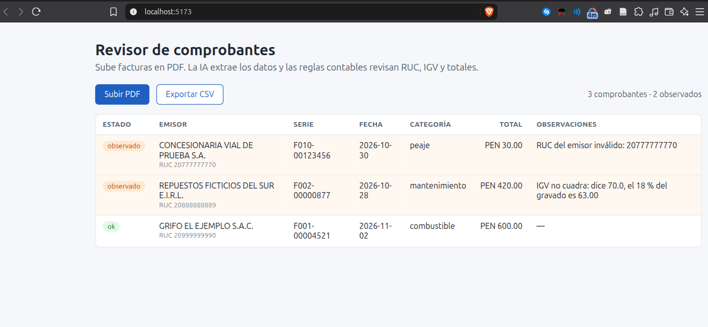

# Revisor de comprobantes con IA

Sube facturas electrónicas peruanas en PDF. Un LLM extrae los datos y unas reglas deterministas revisan que cuadren: RUC, serie, IGV y totales. Lo que no cuadra queda marcado para que lo revise una persona.



Está pensado para una empresa de transportes, que recibe facturas de combustible, peajes y repuestos. Por eso también clasifica cada gasto.


## Cómo funciona

```
PDF → texto (pypdf) → LLM devuelve JSON → Pydantic valida la forma
    → reglas contables → PostgreSQL → API REST → React
```

La IA lee el documento, pero no se le cree a ciegas. Si el JSON no tiene la forma esperada, se rechaza. Si las cuentas no cuadran, se guarda como `observado`, con el motivo, y no se corrige en silencio.

| regla | qué revisa |
|---|---|
| RUC | largo, prefijo y dígito verificador (módulo 11) |
| Serie y número | formato `F001-123` |
| Fecha | que no esté en el futuro |
| IGV | 18 % del monto gravado, con tolerancia de 2 céntimos por redondeo |
| Total | gravado + IGV + otros montos |

## Stack

FastAPI · SQLAlchemy · PostgreSQL · Pydantic · React (Vite) · Docker Compose · pytest · API de LLM compatible con OpenAI (probado con Groq y `openai/gpt-oss-120b`)

## Cómo correrlo

```bash
cp .env.example .env     # y pon tu clave de https://console.groq.com/keys
docker compose up -d --build
```

- Interfaz: http://localhost:5173
- API y documentación (Swagger): http://localhost:8000/docs
- En `ejemplos/` hay 3 facturas ficticias: una correcta, una con el IGV mal y una con el RUC inválido.

Pruebas:

```bash
python -m venv .venv && .venv/bin/pip install -r backend/requirements.txt pytest httpx
cd backend
../.venv/bin/pytest                                              # sin internet: el LLM se reemplaza por uno falso
set -a; . ../.env; set +a; ../.venv/bin/pytest -m integracion    # con el LLM real: gasta cuota
```

La aplicación corre en local (`127.0.0.1`): no tiene usuarios ni autenticación, así que no está pensada para exponerla a internet tal como está.

## Limitaciones actuales

- Los PDF escaneados no tienen texto: haría falta OCR.
- Si la IA toma el RUC del cliente en vez del emisor, la regla no lo detecta, porque es un RUC válido.
- No consulta a SUNAT si el RUC existe o está activo.
- Solo contempla IGV del 18 %; otra tasa, o un comprobante sin desglose, queda como observado.
- No detecta comprobantes duplicados.
- El texto de los comprobantes se envía al proveedor de IA. Con datos reales habría que usar un modelo local (Ollama) o acordarlo con el cliente.

## Uso de IA en el desarrollo

Dirigí este proyecto y revisé, probé y estudié cada parte. Usé Claude Code, que generó gran parte del código.

En el proceso aparecieron errores de la IA que hubo que corregir:

- Había elegido un modelo que Groq ya había retirado para cuentas gratuitas.
- La ruta de subida era `async` pero hacía una llamada bloqueante, lo que congelaba el servidor mientras esperaba al LLM.
- Un fallo del proveedor respondía 422, como si el error fuera del documento; ahora responde 502.
